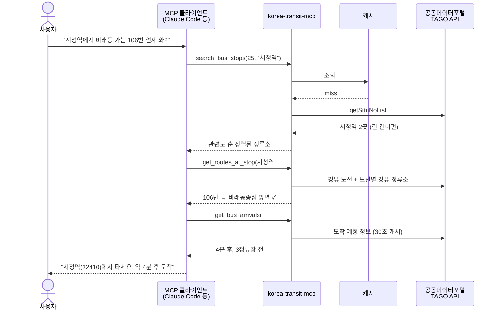

# korea-transit-mcp

[](https://github.com/98Woonho/korea-transit-mcp/actions/workflows/ci.yml)


[](LICENSE)

공공데이터포털(data.go.kr)의 전국 버스 Open API를 AI 에이전트가 쓸 수 있게 만든 **MCP(Model Context Protocol) 서버**입니다.
Claude Code, Claude Desktop, Cursor 같은 MCP 클라이언트에서 "시청역에서 106번 언제 와?" 같은 질문에 **실시간 데이터로** 답할 수 있습니다.

<p align="center">
  
</p>

## 작동 방식

사용자가 질문하면 LLM(MCP 클라이언트)이 필요한 도구를 스스로 골라 순서대로 호출합니다. 서버는 공공 API를 호출해 정규화된 결과만 돌려주고, **LLM을 직접 호출하지 않습니다.**



## 제공 도구 (Tools)

국토교통부 TAGO 버스 API 4종(정류소·도착·노선·위치)을 감싼 9개 도구입니다. 서울은 TAGO에 포함되지 않습니다.

| 분류 | Tool | 설명 |
|---|---|---|
| 정류소 | `list_cities` | 지원 도시와 도시 코드 조회 (전국 138개) |
| | `search_bus_stops` | 정류소명/번호 검색, 관련도 순 정렬 |
| | `find_nearby_stops` | 좌표 주변 정류소, 가까운 순 + 거리(m) |
| | `get_routes_at_stop` | 정류소 경유 노선 + **다음 정류소·방면** (같은 이름의 길 건너편 정류소 구분) |
| 도착 | `get_bus_arrivals` | 실시간 도착 예정 (분, 남은 정류장 수, 곧 도착) |
| 노선 | `search_routes` | 노선 번호 검색, 첫차·막차 |
| | `get_route_info` | 기점·종점, 배차간격 (평일/토/일) |
| | `get_route_stops` | 노선 경유 정류소 순서와 방향 |
| 위치 | `get_bus_locations` | 운행 중인 버스의 현재 정류소와 향하는 종점 |

### 예시: 이름이 같은 정류소 구분
"시청역"으로 검색하면 길 건너편 정류소 두 곳이 나옵니다. 공공 API의 "정류소 경유 노선"에는 방향 정보가 없지만,
이 서버는 노선별 경유 정류소 순서와 방향 코드(`updowncd`)를 합쳐서 방면을 계산합니다.

```
시청역(32410)  617번: 다음 목련아파트 / 비래동종점 방면
시청역(32390)  617번: 다음 시청.교육청 / 가장제일장로교회 방면
```

## 설계 원칙: LLM 비용 0원

- 서버는 **LLM을 호출하지 않습니다.** 추론은 사용자의 MCP 클라이언트가 하고, 서버는 결정적인 도구만 제공합니다.
- 잘 바뀌지 않는 데이터(도시 코드, 정류소)는 **TTL 캐시**로 공공 API 일일 호출 한도를 아낍니다.
- 테스트는 가짜 fetch와 인메모리 MCP 트랜스포트로 돌아가서 **CI에서 네트워크와 LLM 비용이 들지 않습니다.**

## 시작하기

### 1. 인증키 발급
1. [공공데이터포털](https://www.data.go.kr) 회원가입
2. "국토교통부_(TAGO)_버스정류소정보" 등 필요한 API에 **활용신청** (대부분 자동승인)
3. 마이페이지 > 개인 API 인증키에서 **Decoding 키**를 복사

### 2. MCP 클라이언트에 연결 (설치 불필요, `npx`로 실행)

**Claude Code**
```bash
claude mcp add korea-transit -e DATA_GO_KR_SERVICE_KEY=발급받은_Decoding_키 -- npx -y korea-transit-mcp
```

**Claude Desktop / Cursor 등** 설정 파일의 `mcpServers`에 추가:
```json
{
  "mcpServers": {
    "korea-transit": {
      "command": "npx",
      "args": ["-y", "korea-transit-mcp"],
      "env": { "DATA_GO_KR_SERVICE_KEY": "발급받은_Decoding_키" }
    }
  }
}
```

Node.js 20.12 이상이 필요합니다.

## 개발

```bash
npm install
cp .env.example .env   # DATA_GO_KR_SERVICE_KEY 입력
npm test               # 네트워크·LLM 없이 도는 테스트
npm run smoke          # 실제 API로 전체 도구 점검
npm run inspect        # MCP Inspector로 도구 직접 실행
```

이 저장소를 Claude Code로 열면 [.mcp.json](.mcp.json)으로 로컬 빌드(`dist/`)가 자동 연결되고, 키는 서버가 `.env`에서 직접 읽습니다.

## 구조

```
src/
  index.ts              # stdio 엔트리포인트
  server.ts             # 의존성 조립
  cache.ts              # TTL 캐시 (원격 배포 시 KV로 교체 가능)
  datagokr/client.ts    # data.go.kr 공통 클라이언트 (응답 정규화, 오류 처리)
  tago/                 # TAGO API 어댑터: 원본 필드 → 정규화된 도메인 객체
    stations.ts         #   정류소 (검색, 주변, 경유 노선)
    arrivals.ts         #   도착 정보
    routes.ts           #   노선, 경유 정류소, 버스 위치, 방향 계산
  tools/                # MCP 도구 정의 (설명, 입력 스키마, 응답 가공)
scripts/smoke.ts        # 실제 API로 전체 도구 점검
test/                   # 가짜 fetch + 인메모리 MCP 클라이언트 테스트
docs/public-apis.md     # 사용 가능한 공공 API 정리
```

### 캐시 정책 (공공 API 일일 한도 보호)
| 데이터 | TTL |
|---|---|
| 도시 코드 | 24시간 |
| 정류소, 노선, 경유 정류소/노선 | 6시간 |
| 도착 정보 | 30초 |
| 버스 위치 | 15초 |

## License
MIT
