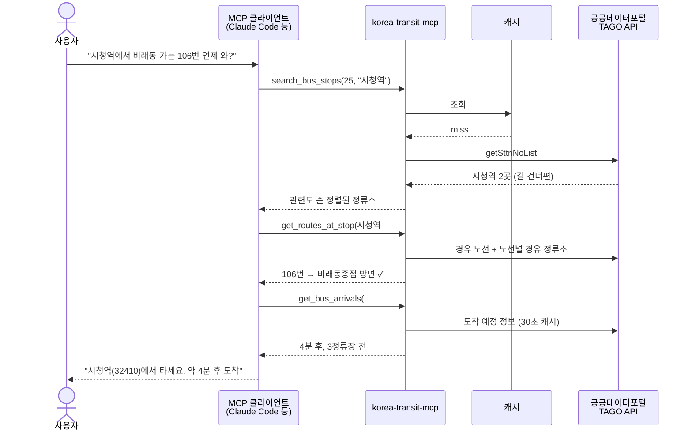

# korea-transit-mcp

[](https://github.com/98Woonho/korea-transit-mcp/actions/workflows/ci.yml)


[](LICENSE)

공공데이터포털(data.go.kr)의 전국 버스 Open API를 AI 에이전트가 쓸 수 있게 만든 **MCP(Model Context Protocol) 서버**입니다.
Claude Code, Claude Desktop, Cursor 같은 MCP 클라이언트에서 "시청역에서 106번 언제 와?" 같은 질문에 **실시간 데이터로** 답할 수 있습니다.

**🌐 소개 페이지: [98woonho.github.io/projects/korea-transit-mcp](https://98woonho.github.io/projects/korea-transit-mcp)** (길 건너편 정류장 구분, 1회 환승, 운행관리 리포트 데모)

<p align="center">
  
</p>

## 작동 방식

사용자가 질문하면 LLM(MCP 클라이언트)이 필요한 도구를 스스로 골라 순서대로 호출합니다. 서버는 공공 API를 호출해 정규화된 결과만 돌려주고, **LLM을 직접 호출하지 않습니다.**



## 제공 도구 (Tools)

국토교통부 TAGO 버스 API 4종(정류소·도착·노선·위치)을 감싼 조회 도구 9개와, 여러 API를 조합해 계산하는 분석 도구 3개입니다. 서울은 TAGO에 포함되지 않습니다.

| 분류 | Tool | 설명 |
|---|---|---|
| 정류소 | `list_cities` | 지원 도시와 도시 코드 조회 (전국 138개) |
| | `search_bus_stops` | 정류소명/번호 검색, 관련도 순 정렬 |
| | `find_nearby_stops` | 좌표 주변 정류소, 가까운 순 + 거리(m) |
| | `get_routes_at_stop` | 정류소 경유 노선 + **다음 정류소·방면** (같은 이름의 길 건너편 정류소 구분) |
| 도착 | `get_bus_arrivals` | 실시간 도착 예정 (분, 남은 정류장 수, 곧 도착) |
| 노선 | `search_routes` | 노선 번호 검색, 첫차·막차 |
| | `get_route_info` | 기점·종점, 배차간격 (평일/토/일) |
| | `get_route_stops` | 노선 경유 정류소 순서와 방향 |
| 위치 | `get_bus_locations` | 운행 중인 버스의 현재 정류소와 향하는 종점 |
| 분석 | `find_direct_routes` | 출발·도착 사이 **직통 노선**. 같은 이름 후보를 모두 받아 어느 쪽에서 타야 하는지까지 판별 |
| | `find_transfer_routes` | 직통이 없을 때 **1회 환승 경로**. 두 노선의 경유 순서·방향을 대조해 실제로 이어지는 경로만, 같은 정류소 또는 걸어서(기본 200m 이내) 갈아타기 |
| | `analyze_headway` | 운행 중인 버스의 **앞뒤 차 간격**: 정류장 수, 균등 배치 대비 비율, 추정 분 |

분석 도구는 LLM이 여러 번 호출해 직접 맞춰 볼 일을 **서버에서 한 번에 결정적으로 계산**합니다. 결과가 정확하고 테스트할 수 있으며, 클라이언트 토큰도 아낍니다.
몰림·공백 같은 **판단 기준은 도구가 아니라 Skill**이 정합니다.

### 예시: 이름이 같은 정류소 구분
"시청역"으로 검색하면 길 건너편 정류소 두 곳이 나옵니다. 공공 API의 "정류소 경유 노선"에는 방향 정보가 없지만,
이 서버는 노선별 경유 정류소 순서와 방향 코드(`updowncd`)를 합쳐서 방면을 계산합니다.

```
시청역(32410)  617번: 다음 목련아파트 / 비래동종점 방면
시청역(32390)  617번: 다음 시청.교육청 / 가장제일장로교회 방면
```

## 품질 검증

> **한 줄 요약:** 같은 도구를 주고 **Skill만 넣고 뺐더니** 검사 통과율이 **70% → 100%**로 올랐습니다. 차이가 가장 큰 곳은 운행 리포트의 판정이었습니다(2/7 → 7/7).
>
> Skill은 Claude에게 "이런 질문에는 이 순서로 도구를 쓰고, 이 기준으로 판단하라"고 알려 주는 지침서입니다. 이 저장소에는 [이동 안내](plugin/skills/bus-trip/SKILL.md)와 [운행 리포트](plugin/skills/route-ops-report/SKILL.md) 두 개가 있습니다.

### 세 가지 방법으로 확인합니다

| 방법 | 확인하는 것 | 실행 | 비용 |
|---|---|---|---|
| 자동 테스트 | 계산이 맞는지 (간격 비율, 환승 경로가 실제로 이어지는지, 응답 정리 등) | `npm test`, push할 때마다 GitHub에서 자동 실행 | 무료 |
| 실제 API 점검 | 12개 도구가 공공데이터포털 실데이터로 동작하는지 | `npm run smoke` | 무료 |
| Skill 평가 | Claude가 Skill대로 도구를 쓰고 답하는지 | `npm run eval` | 1회 약 $1 |

### Skill 평가는 시험처럼 진행합니다

1. **문제:** 실제 사용자처럼 질문합니다. 예: "대전 목원대학교에서 신탄진역까지 버스로 어떻게 가?" (문제 6개, [`plugin/evals/`](plugin/evals/))
2. **답안:** Claude(Opus 5.5)가 실제 도구로 실시간 데이터를 조회해 답합니다.
3. **채점:** 문제마다 정해 둔 확인 항목을 하나씩 채점합니다. 채점 방법은 두 가지입니다.

| 채점 방법 | 이런 항목에 씁니다 | 누가 |
|---|---|---|
| **규칙 채점** | "환승 탐색 도구를 목원대·신탄진역 정류장으로 불렀는가", "직통 탐색을 먼저 했는가"처럼 **기록만 보면 답이 정해지는** 항목 | 프로그램. 매번 같은 결과 |
| **AI 채점** | "직통 노선이 없다고 분명히 말했는가"처럼 **문장을 읽고 판단해야 하는** 항목 | Claude Haiku가 3번 판단해 다수결 |

두 가지를 나눈 이유가 있습니다. 평가 도구는 AI 채점관에게 실행 기록이 길면 **앞부분과 뒷부분만** 보여 줍니다(앞뒤 12개 메시지). 가운데 있던 도구 호출은 AI 채점관이 볼 수 없어서, "어떤 도구를 불렀나"는 규칙 채점으로, "어떻게 답했나"는 항상 보이는 최종 답변을 AI가 채점하도록 나눴습니다.

### 결과 1: Skill이 있을 때와 없을 때 (2026-11-17, v0.3.2)

| 문제 | 확인 항목 | Skill 있음 | Skill 없음 |
|---|---|---|---|
| 길 건너편 정류장 구분 (시청역 → 목련아파트) | 맞는 쪽 정류장(32410) 안내, 반대편 주의, 없는 노선 지어내지 않기 등 | 5/5 | 5/5 |
| 직통 노선 없음 (목원대 → 신탄진역) | 직통 없음 안내, 확인 안 된 환승 경로 지어내지 않기 등 | 4/4 | 4/4 |
| 도시를 말하지 않음 | 도시를 묻거나, 가정한 도시를 밝히기 | 1/1 | 1/1 |
| **106번 운행 리포트** | 판정 기준대로 몰림·공백 판정, 종점·기점 구간 제외, 노선 등급 | 7/7 | **2/7** |
| 사용자 기준 우선 ("2배부터 공백") | 사용자가 말한 기준 적용 | 2/2 | 2/2 |
| 승객의 도착 문의 | 운행 리포트로 착각하지 않기 | 2/2 | 2/2 |
| **합계** | | **23/23 (100%)** | **16/23 (70%)** |

**알게 된 것**
- **Skill의 효과는 "판단"에서 나타났습니다.** Skill이 없으면 분석 도구는 똑같이 불렀지만, 판정에서 빼야 할 기점 구간을 "심한 공백"으로 판정하고, 정상 범위(1.48배)도 공백으로 올리고, 노선 등급을 내지 않았습니다.
- **길 건너편 정류장 구분은 Skill이 없어도 맞혔습니다.** 정류장 후보를 모두 받아 서버가 판별하도록 도구를 설계했기 때문입니다. "계산은 도구에, 판단 기준은 Skill에"라는 원칙이 결과로 확인됐습니다.
- **Skill이 지나치게 조심스러운 곳도 찾았습니다.** 직통 노선이 없을 때 Skill은 "환승은 확인할 수 없다"며 지도 앱을 권했습니다. 그런데 Skill 없는 Claude는 노선별 정류장 목록을 직접 대조해 맞는 환승 경로를 찾아냈습니다. 그래서 이 계산을 서버 도구(`find_transfer_routes`)로 만들었습니다. → 결과 2

### 결과 2: 환승 도구 추가 후 (2026-11-17, v0.4.0)

"목원대 → 신탄진역" 문제를 다시 풀게 했습니다.

| 확인 항목 | 채점 | 결과 |
|---|---|---|
| 직통 노선부터 찾았다 (목원대·신탄진역 정류장으로) | 규칙 | ✅ |
| 직통 노선이 없다고 안내했다 | AI | ✅ |
| 그다음 환승 경로를 찾았다 (직통 → 환승 순서) | 규칙 | ✅ |
| 환승 탐색에 같은 정류장 후보를 넘겼다 | 규칙 | ✅ |
| 두 버스 번호, 탈 곳, 갈아탈 정류장 번호까지 안내했다 | AI | ✅ |

**5/5 (비용 $0.20).** 실제 답변: "목원대학교(33230)에서 106번 → 29정류장 뒤 복합터미널(12010)에서 같은 정류장의 급행 2번으로 환승 → 10정류장 뒤 신탄진역". 같은 시각 실제 API 점검 결과와 일치했습니다.

<details>
<summary><b>채점을 믿을 수 있는지 확인한 과정과 한계</b></summary>

**AI 채점을 사람이 다시 확인했습니다.** 결과 1의 46개 판정(23개 항목 × 2)을 실행 기록과 하나씩 대조했고, 운행 리포트는 도구 결과로 등급을 직접 다시 계산했습니다. 1개가 틀렸습니다. Skill 없는 Claude의 환승 경로를 "확인 안 된 경로"로 감점했는데, 실제로는 도구로 확인된 맞는 경로였습니다. 원인은 AI가 아니라 제가 쓴 채점 기준 문장에 "어떤 도구도 환승을 확인하지 않았으므로"라는 틀린 전제가 있었던 것입니다. 이 판정을 고쳐서 Skill 없음 결과가 15/23에서 16/23이 됐습니다.

**한계**
- 문제당 1번만 풀게 해서 표본이 작습니다.
- 실시간 데이터라 두 조건이 본 상황이 조금 다릅니다(약 6분 차이). Skill 있을 때는 106번 간격이 마침 모두 정상이어서 "몰림·공백을 기준대로 판정하는가"는 제대로 시험되지 않았습니다.
- "판정 기준 파일을 읽었다", "리포트 형식" 같은 항목은 Skill이 정한 것이라 Skill이 없으면 틀리는 게 당연합니다.
- 결과 1의 실행 12개 중 8개는 AI 채점관이 기록 가운데를 보지 못했습니다(위의 "앞뒤만 보여 주는" 문제). 저장된 기록도 똑같이 잘려 있어서, 그 구간의 도구 호출은 사람의 재확인으로도 볼 수 없었습니다. 그 뒤 모든 문제의 "○○ 도구를 불렀다" 항목을 규칙 채점으로 바꾸고, 답변 내용 항목은 최종 답변만 보도록 바꿨습니다. 결과 1은 바꾸기 전 방식으로 채점한 것입니다.

</details>

### 다시 평가하기
```bash
npm run eval                            # 전체 6문제, 1번씩, 비용 상한 $3
npm run eval -- --case no-direct-route  # 한 문제만
npm run eval -- --model sonnet          # 답하는 모델 바꾸기 (기본: 지금 Claude Code 설정 모델)
```
Claude Code CLI(`claude`)가 필요합니다. 저장소 안에서 실행하면 플러그인이 이 저장소의 빌드를 쓰므로 릴리스 전 변경을 평가할 수 있고, 인증키는 `.env`에서 읽습니다.

## 설계 원칙: LLM 비용 0원

- 서버는 **LLM을 호출하지 않습니다.** 추론은 사용자의 MCP 클라이언트가 하고, 서버는 결정적인 도구만 제공합니다.
- 잘 바뀌지 않는 데이터(도시 코드, 정류소)는 **TTL 캐시**로 공공 API 일일 호출 한도를 아낍니다.
- 테스트는 가짜 fetch와 인메모리 MCP 트랜스포트로 돌아가서 **CI에서 네트워크와 LLM 비용이 들지 않습니다.**

## 시작하기

### 1. 인증키 발급
1. [공공데이터포털](https://www.data.go.kr) 회원가입
2. "국토교통부_(TAGO)_버스정류소정보" 등 필요한 API에 **활용신청** (대부분 자동승인)
3. 마이페이지 > 개인 API 인증키에서 **Decoding 키**를 복사

### 2-A. Claude Code 플러그인으로 설치 (추천: MCP 서버 + Skill 한 번에)

```
/plugin install korea-transit --marketplace 98Woonho/korea-transit-mcp
```

플러그인을 켤 때 **인증키 입력 창**이 뜹니다. 키는 OS 보안 저장소에 보관되고 설정 파일에는 남지 않습니다.
설치하면 MCP 도구 12개와 함께 아래 Skill이 들어옵니다.

| Skill | 이렇게 물어보세요 | 하는 일 |
|---|---|---|
| `korea-transit:bus-trip` | "대전 시청역에서 목련아파트까지 버스 뭐 타?" | 길 건너편 정류장까지 구분해 탈 곳, 노선, 실시간 도착을 안내. 직통이 없으면 검증된 1회 환승 경로 |
| `korea-transit:route-ops-report` | "대전 106번 운행 상태 분석해줘" | 배차간격 대비 몰림·공백 구간을 판정한 운행관리 리포트 |

### 2-B. MCP 서버만 연결 (다른 클라이언트, `npx`로 실행)

**Claude Code**
```bash
claude mcp add korea-transit -e DATA_GO_KR_SERVICE_KEY=발급받은_Decoding_키 -- npx -y korea-transit-mcp
```

**Claude Desktop / Cursor 등** 설정 파일의 `mcpServers`에 추가:
```json
{
  "mcpServers": {
    "korea-transit": {
      "command": "npx",
      "args": ["-y", "korea-transit-mcp"],
      "env": { "DATA_GO_KR_SERVICE_KEY": "발급받은_Decoding_키" }
    }
  }
}
```

Node.js 20.12 이상이 필요합니다.

## 개발

```bash
npm install
cp .env.example .env   # DATA_GO_KR_SERVICE_KEY 입력
npm test               # 네트워크·LLM 없이 도는 테스트
npm run smoke          # 실제 API로 전체 도구 점검
npm run inspect        # MCP Inspector로 도구 직접 실행
```

이 저장소를 Claude Code로 열면 [.mcp.json](.mcp.json)으로 로컬 빌드(`dist/`)가 자동 연결되고, 키는 서버가 `.env`에서 직접 읽습니다.

릴리스는 `npm version` 후 태그를 push하면 GitHub Actions가 npm 배포(Trusted Publishing)와 MCP 레지스트리 갱신까지 자동으로 합니다. 자세한 내용은 [docs/RELEASING.md](docs/RELEASING.md)를 참고하세요.

## 구조

```
src/
  index.ts              # stdio 엔트리포인트
  server.ts             # 의존성 조립
  cache.ts              # TTL 캐시 (원격 배포 시 KV로 교체 가능)
  datagokr/client.ts    # data.go.kr 공통 클라이언트 (응답 정규화, 오류 처리)
  tago/                 # TAGO API 어댑터: 원본 필드 → 정규화된 도메인 객체
    stations.ts         #   정류소 (검색, 주변, 경유 노선)
    arrivals.ts         #   도착 정보
    routes.ts           #   노선, 경유 정류소, 버스 위치, 방향 계산
  analysis/             # 순수 계산 로직 (직통·환승 경로, 운행 간격 분석) — API 호출 없음
  tools/                # MCP 도구 정의 (설명, 입력 스키마, 응답 가공)
plugin/                 # Claude Code 플러그인 (마켓플레이스: .claude-plugin/marketplace.json)
  .claude-plugin/plugin.json  # 매니페스트, 인증키 입력(userConfig)
  .mcp.json             #   npm 패키지를 실행하는 MCP 설정
  bin/launch.mjs        #   플러그인 버전과 같은 npm 버전을 실행 (Windows 호환)
  skills/               #   bus-trip, route-ops-report
scripts/smoke.ts        # 실제 API로 전체 도구 점검
test/                   # 가짜 fetch + 인메모리 MCP 클라이언트 테스트
docs/public-apis.md     # 사용 가능한 공공 API 정리
showcase/               # 포트폴리오 사이트가 빌드 시 읽는 소개 자료
  showcase.json         #   소개, 링크, 설치 안내, 도구 분류
  demos/*.json          #   데모 시나리오: 실제 실행 기록을 요약한 녹화본 (사이트에서 애니메이션으로 재생)
```

### 캐시 정책 (공공 API 일일 한도 보호)
| 데이터 | TTL |
|---|---|
| 도시 코드 | 24시간 |
| 정류소, 노선, 경유 정류소/노선 | 6시간 |
| 도착 정보 | 30초 |
| 버스 위치 | 15초 |

## License
MIT
