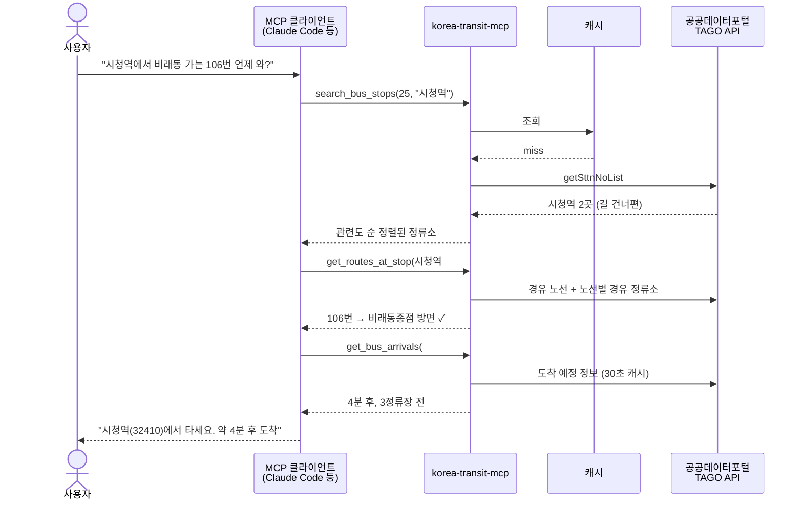

# korea-transit-mcp

[](https://github.com/98Woonho/korea-transit-mcp/actions/workflows/ci.yml)


[](LICENSE)

공공데이터포털(data.go.kr)의 전국 버스 Open API를 AI 에이전트가 쓸 수 있게 만든 **MCP(Model Context Protocol) 서버**입니다.
Claude Code, Claude Desktop, Cursor 같은 MCP 클라이언트에서 "시청역에서 106번 언제 와?" 같은 질문에 **실시간 데이터로** 답할 수 있습니다.

<p align="center">
  
</p>

## 작동 방식

사용자가 질문하면 LLM(MCP 클라이언트)이 필요한 도구를 스스로 골라 순서대로 호출합니다. 서버는 공공 API를 호출해 정규화된 결과만 돌려주고, **LLM을 직접 호출하지 않습니다.**



## 제공 도구 (Tools)

국토교통부 TAGO 버스 API 4종(정류소·도착·노선·위치)을 감싼 조회 도구 9개와, 여러 API를 조합해 계산하는 분석 도구 2개입니다. 서울은 TAGO에 포함되지 않습니다.

| 분류 | Tool | 설명 |
|---|---|---|
| 정류소 | `list_cities` | 지원 도시와 도시 코드 조회 (전국 138개) |
| | `search_bus_stops` | 정류소명/번호 검색, 관련도 순 정렬 |
| | `find_nearby_stops` | 좌표 주변 정류소, 가까운 순 + 거리(m) |
| | `get_routes_at_stop` | 정류소 경유 노선 + **다음 정류소·방면** (같은 이름의 길 건너편 정류소 구분) |
| 도착 | `get_bus_arrivals` | 실시간 도착 예정 (분, 남은 정류장 수, 곧 도착) |
| 노선 | `search_routes` | 노선 번호 검색, 첫차·막차 |
| | `get_route_info` | 기점·종점, 배차간격 (평일/토/일) |
| | `get_route_stops` | 노선 경유 정류소 순서와 방향 |
| 위치 | `get_bus_locations` | 운행 중인 버스의 현재 정류소와 향하는 종점 |
| 분석 | `find_direct_routes` | 출발·도착 사이 **직통 노선**. 같은 이름 후보를 모두 받아 어느 쪽에서 타야 하는지까지 판별 |
| | `analyze_headway` | 운행 중인 버스의 **앞뒤 차 간격**: 정류장 수, 균등 배치 대비 비율, 추정 분 |

분석 도구는 LLM이 여러 번 호출해 직접 맞춰 볼 일을 **서버에서 한 번에 결정적으로 계산**합니다. 결과가 정확하고 테스트할 수 있으며, 클라이언트 토큰도 아낍니다.
몰림·공백 같은 **판단 기준은 도구가 아니라 Skill**이 정합니다.

### 예시: 이름이 같은 정류소 구분
"시청역"으로 검색하면 길 건너편 정류소 두 곳이 나옵니다. 공공 API의 "정류소 경유 노선"에는 방향 정보가 없지만,
이 서버는 노선별 경유 정류소 순서와 방향 코드(`updowncd`)를 합쳐서 방면을 계산합니다.

```
시청역(32410)  617번: 다음 목련아파트 / 비래동종점 방면
시청역(32390)  617번: 다음 시청.교육청 / 가장제일장로교회 방면
```

## 품질 검증

세 층으로 검증합니다. 위의 두 층은 비용이 0원이고, Skill 평가만 LLM 비용이 들어 필요할 때 직접 실행합니다.

| 층 | 무엇을 | 어떻게 | 비용 |
|---|---|---|---|
| 단위·프로토콜 테스트 | 응답 정규화, 판정 계산, 설정 일관성, MCP 도구 호출 | `npm test` (가짜 fetch + 인메모리 MCP 클라이언트), push마다 CI | 0원 |
| 실제 API 점검 | 11개 도구가 실데이터에서 동작하는지 | `npm run smoke` | 0원 (공공 API 호출 수십 건) |
| **Skill 평가** | Claude가 Skill대로 판단·답변하는지 | `npm run eval` ([`claude plugin eval`](plugin/evals/)) | 약 $1 / 1회 |

### Skill 평가 결과 (2026-11-17, 케이스당 1회, 실시간 데이터)

같은 MCP 도구를 둔 채 **Skill만 넣고 뺀** 두 조건으로 6개 케이스(검사 항목 23개)를 돌렸습니다. 채점은 LLM 심사위원(투표 3회)이 실행 기록 전체를 보고 합니다.

| 케이스 | 검사 | Skill 있음 | Skill 없음 |
|---|---|---|---|
| 반대편 정류장 구분 (시청역 → 목련아파트) | 후보 전체 전달, 32410 탑승 안내, 반대편 주의, 노선 지어내지 않기 | 5/5 | 5/5 |
| **직통 노선 없음** (목원대 → 신탄진역) | 직통 없음 안내, **검증 안 된 환승 경로 제시 금지**, 대안 제시 | 4/4 | **3/4** |
| 도시 미지정 | 도시를 묻거나 가정을 밝히기 | 1/1 | 1/1 |
| **106번 운행 리포트** | 판정 기준 적용, 회차·기점 구간 제외, 등급, 형식 | 7/7 | **2/7** |
| 사용자 기준 우선 ("2배부터 공백") | 사용자 기준 적용·명시 | 2/2 | 2/2 |
| 승객 도착 문의 | 운행 리포트로 오발동하지 않기 | 2/2 | 2/2 |
| **합계** | | **23/23 (100%)** | **15/23 (65%)** |

**알게 된 것**
- **Skill이 결정적인 곳은 "판단"입니다.** Skill 없이도 `analyze_headway`는 호출했지만, 회차·기점 구간을 판정에서 빼지 않았고 등급 기준도 일관되지 않았습니다. 판단 기준을 Skill로 분리한 설계가 효과가 있었습니다.
- **Skill이 없으면 환승 경로를 지어냈습니다.** 직통 노선이 없자 도구로 확인하지 않은 "106번 → 703번 환승"을 추천 경로로 제시했습니다. Skill의 "검증할 수 없는 경로를 만들지 않는다"는 지침이 이 실수를 막았습니다.
- **정류장 구분은 Skill이 없어도 통과했습니다.** 후보를 모두 받아 서버가 판별하는 `find_direct_routes`의 **도구 설계**가 이미 그 일을 하고 있기 때문입니다. 계산은 도구에, 판단은 Skill에 둔다는 원칙이 결과에서도 드러났습니다.

**한계:** 케이스당 1회 실행이라 표본이 작습니다. "판정 기준 파일을 읽었다", "리포트 5개 절" 같은 일부 항목은 Skill이 정의한 형식이라, Skill이 없으면 실패하는 것이 당연합니다. 이런 항목을 빼고 보면, 차이를 만든 핵심 항목은 판정 정확도, 예외 구간 처리, 환승 경로 지어내기입니다.

### 다시 평가하기
```bash
npm run eval                            # 전체 6개 케이스, 케이스당 1회, 비용 상한 $3
npm run eval -- --case no-direct-route  # 한 케이스만
```
Claude Code CLI(`claude`)가 필요합니다. 저장소 안에서 실행하면 플러그인이 **로컬 빌드**를 쓰므로 릴리스 전 변경을 평가할 수 있고, 인증키는 `.env`에서 읽습니다.

## 설계 원칙: LLM 비용 0원

- 서버는 **LLM을 호출하지 않습니다.** 추론은 사용자의 MCP 클라이언트가 하고, 서버는 결정적인 도구만 제공합니다.
- 잘 바뀌지 않는 데이터(도시 코드, 정류소)는 **TTL 캐시**로 공공 API 일일 호출 한도를 아낍니다.
- 테스트는 가짜 fetch와 인메모리 MCP 트랜스포트로 돌아가서 **CI에서 네트워크와 LLM 비용이 들지 않습니다.**

## 시작하기

### 1. 인증키 발급
1. [공공데이터포털](https://www.data.go.kr) 회원가입
2. "국토교통부_(TAGO)_버스정류소정보" 등 필요한 API에 **활용신청** (대부분 자동승인)
3. 마이페이지 > 개인 API 인증키에서 **Decoding 키**를 복사

### 2-A. Claude Code 플러그인으로 설치 (추천: MCP 서버 + Skill 한 번에)

```
/plugin install korea-transit --marketplace 98Woonho/korea-transit-mcp
```

플러그인을 켤 때 **인증키 입력 창**이 뜹니다. 키는 OS 보안 저장소에 보관되고 설정 파일에는 남지 않습니다.
설치하면 MCP 도구 11개와 함께 아래 Skill이 들어옵니다.

| Skill | 이렇게 물어보세요 | 하는 일 |
|---|---|---|
| `korea-transit:bus-trip` | "대전 시청역에서 목련아파트까지 버스 뭐 타?" | 길 건너편 정류장까지 구분해 탈 곳, 노선, 실시간 도착을 안내 |
| `korea-transit:route-ops-report` | "대전 106번 운행 상태 분석해줘" | 배차간격 대비 몰림·공백 구간을 판정한 운행관리 리포트 |

### 2-B. MCP 서버만 연결 (다른 클라이언트, `npx`로 실행)

**Claude Code**
```bash
claude mcp add korea-transit -e DATA_GO_KR_SERVICE_KEY=발급받은_Decoding_키 -- npx -y korea-transit-mcp
```

**Claude Desktop / Cursor 등** 설정 파일의 `mcpServers`에 추가:
```json
{
  "mcpServers": {
    "korea-transit": {
      "command": "npx",
      "args": ["-y", "korea-transit-mcp"],
      "env": { "DATA_GO_KR_SERVICE_KEY": "발급받은_Decoding_키" }
    }
  }
}
```

Node.js 20.12 이상이 필요합니다.

## 개발

```bash
npm install
cp .env.example .env   # DATA_GO_KR_SERVICE_KEY 입력
npm test               # 네트워크·LLM 없이 도는 테스트
npm run smoke          # 실제 API로 전체 도구 점검
npm run inspect        # MCP Inspector로 도구 직접 실행
```

이 저장소를 Claude Code로 열면 [.mcp.json](.mcp.json)으로 로컬 빌드(`dist/`)가 자동 연결되고, 키는 서버가 `.env`에서 직접 읽습니다.

릴리스는 `npm version` 후 태그를 push하면 GitHub Actions가 npm 배포(Trusted Publishing)와 MCP 레지스트리 갱신까지 자동으로 합니다. 자세한 내용은 [docs/RELEASING.md](docs/RELEASING.md)를 참고하세요.

## 구조

```
src/
  index.ts              # stdio 엔트리포인트
  server.ts             # 의존성 조립
  cache.ts              # TTL 캐시 (원격 배포 시 KV로 교체 가능)
  datagokr/client.ts    # data.go.kr 공통 클라이언트 (응답 정규화, 오류 처리)
  tago/                 # TAGO API 어댑터: 원본 필드 → 정규화된 도메인 객체
    stations.ts         #   정류소 (검색, 주변, 경유 노선)
    arrivals.ts         #   도착 정보
    routes.ts           #   노선, 경유 정류소, 버스 위치, 방향 계산
  analysis/             # 순수 계산 로직 (직통 노선 판별, 운행 간격 분석) — API 호출 없음
  tools/                # MCP 도구 정의 (설명, 입력 스키마, 응답 가공)
plugin/                 # Claude Code 플러그인 (마켓플레이스: .claude-plugin/marketplace.json)
  .claude-plugin/plugin.json  # 매니페스트, 인증키 입력(userConfig)
  .mcp.json             #   npm 패키지를 실행하는 MCP 설정
  bin/launch.mjs        #   플러그인 버전과 같은 npm 버전을 실행 (Windows 호환)
  skills/               #   bus-trip, route-ops-report
scripts/smoke.ts        # 실제 API로 전체 도구 점검
test/                   # 가짜 fetch + 인메모리 MCP 클라이언트 테스트
docs/public-apis.md     # 사용 가능한 공공 API 정리
```

### 캐시 정책 (공공 API 일일 한도 보호)
| 데이터 | TTL |
|---|---|
| 도시 코드 | 24시간 |
| 정류소, 노선, 경유 정류소/노선 | 6시간 |
| 도착 정보 | 30초 |
| 버스 위치 | 15초 |

## License
MIT
